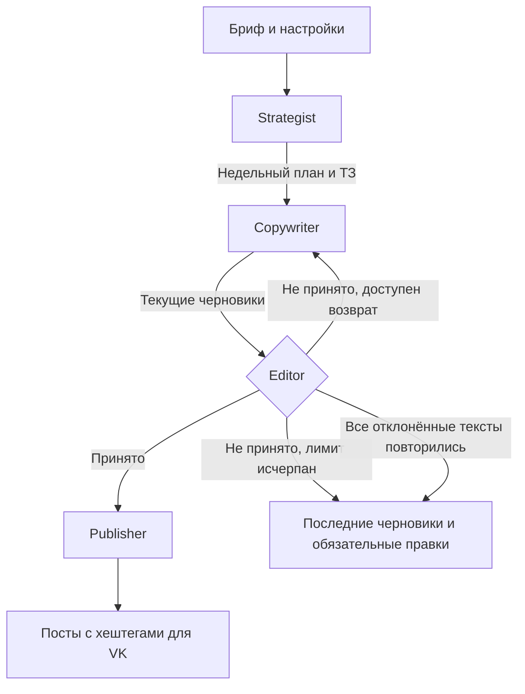

# AI SMM-отдел

Итоговый отчёт по домашнему заданию, 28 ноября 2026 года.

Приложение принимает бриф в браузере, строит контент-план и готовит посты для VK. LangGraph связывает четыре роли, локальная Qwen3-4B выполняет их запросы, а Langfuse сохраняет промпты, ответы и метрики. В контрольном прогоне черновик прошёл путь от отклонения через доработку до одобрения и добавления хештегов.

В базовой конфигурации Docker Compose сервис `ollama` запускает модель `qwen3:4b`, а сервис `python` обслуживает интерфейс FastAPI и запускает тестовые скрипты. Вторая конфигурация добавляет локальный Langfuse и его зависимости.

## Запуск на чистой машине

Понадобятся Git, Docker и Docker Compose v2. Первый запуск требует доступа к реестрам образов и моделей для загрузки Qwen3-4B объёмом около 2,5 ГБ. Веса сохраняются в томе `llm-observability_model_cache` и используются при следующих запусках.

```sh
git clone --branch student https://github.com/avtorpc/llm_bservability_otus_llm.git
cd llm_bservability_otus_llm
```

Для запуска приложения выполните команды из корня репозитория. Для запуска с трассировкой используйте вариант из раздела «Локальный Langfuse».

```sh
docker compose up --build -d --wait --wait-timeout 900
docker compose ps
```

Откройте [AI SMM-отдел](http://127.0.0.1:8000/). При открытии форма заполняет тему, бриф, число дней и постов, лимит возвратов и четыре инструкции из [app/default_task.json](app/default_task.json). Чтобы заменить пример для всех пользователей, отредактируйте этот файл и пересоберите сервис `python`. После запуска кнопка «Входные данные запуска» показывает JSON, принятый сервером. LangGraph последовательно вызывает локальную Qwen3-4B через Ollama, используя инструкции из формы. Если редактор отклоняет комплект, граф возвращает копирайтеру обязательные правки, пока доступна доработка.

Журнал показывает длительность шагов, вызовы модели, токены и тайминги Ollama. Цикл с доработками на CPU может занять несколько минут. Обновление страницы очищает результаты запуска и отметки о публикации.

На этапе редактора Python проверяет, что в основном тексте каждого поста от 30 до 70 слов. Заголовки и хештеги не учитываются. Текст вне диапазона получает обязательную правку и возвращается копирайтеру, пока не исчерпан лимит. Когда длина всех черновиков подходит, Qwen3 проверяет комплект по брифу и ТЗ.

Если после возврата ни один из отклонённых текстов не изменился, граф завершает запуск со статусом «Требуется доработка» и сохраняет последние правки. При сравнении граф игнорирует различия в пробелах и переносах строк.

## Локальный Langfuse

Для запуска с трассировкой понадобится Python 3 на хосте для создания локальных учётных данных. Брифы, промпты, ответы модели и метрики сохраняются в Langfuse по адресу `127.0.0.1:3000`.

```sh
python3 scripts/init_langfuse.py
docker compose --env-file .env.langfuse -f compose.yaml -f docker/langfuse/compose.yaml up --build -d --wait --wait-timeout 900
docker compose --env-file .env.langfuse -f compose.yaml -f docker/langfuse/compose.yaml ps
```

Скрипт один раз создаёт `.env.langfuse` с локальными ключами и паролем. Войдите в [Langfuse](http://127.0.0.1:3000/) с `LANGFUSE_INIT_USER_EMAIL` и `LANGFUSE_INIT_USER_PASSWORD` из этого файла. Проект **AI SMM** создаётся при первом запуске. Файл с учётными данными исключён из Git.

После запуска графа в журнале появляется ссылка «Открыть trace в Langfuse». В trace есть шаг каждого агента и вложенный вызов Ollama для каждой попытки. У вызовов видны вход и выход, токены и тайминги. Для локального вызова в Langfuse записана нулевая стоимость по тарифу за токены. Запись может появиться с небольшой задержкой.

Чтобы остановить весь набор сервисов и сохранить трассы в Docker-томах, используйте те же параметры Compose.

```sh
docker compose --env-file .env.langfuse -f compose.yaml -f docker/langfuse/compose.yaml down
```

Конфигурация основана на [руководстве Langfuse по локальному запуску](https://langfuse.com/self-hosting/deployment/docker-compose). Для хранения объектов используется S3-совместимый [VersityGW](https://github.com/versity/versitygw). При пересборке с включённым Langfuse используйте оба файла Compose и `.env.langfuse`, как в команде запуска выше. Обычный запуск из `compose.yaml` подходит для работы с журналом в браузере.

## Проверка модели отдельно

Python-контейнер запускается после того, как Ollama подтвердит наличие модели. Вывод `docker compose logs -f ollama` показывает состояние загрузки.

```sh
docker compose exec -T python python scripts/check_ollama.py --url http://ollama:11434
```

Скрипт пишет промежуточные сообщения в `stderr`, а JSON с замерами — в `stdout`.

При запуске теста из PyCharm на хосте используйте адрес `http://127.0.0.1:11435`, заданный в скрипте по умолчанию. После редактирования скриптов пересоберите Python-образ командой `docker compose up --build -d python`.

Команда `docker compose down` останавливает оба контейнера и сохраняет том с моделью.

Отдельная проверка до и после контейнеризации воспроизвела ответы и расход токенов — **464 входных и 247 выходных** за три вызова в каждом прогоне. Суммарное время на клиенте составило **102,19 с** в исходном прогоне и **84,19 и 83,24 с** в двух контейнерных прогонах. Эти замеры показывают разброс задержек при разных состояниях модели. [Методика и подробные замеры](TEST_LOCAL_LLM.md)

## Граф и передача контекста



Стратег составляет план и выбирает темы для трёх готовых постов. Копирайтер пишет по выбранным ТЗ и исходному брифу. Редактор проверяет весь комплект. При отклонении он указывает обязательную правку и идентификатор поста. Копирайтер получает исходное ТЗ, предыдущий черновик и правки, а после исправления редактор повторно проверяет весь комплект. Паблишер добавляет хештеги к одобренному тексту для ручной публикации в VK.

Схема ответа редактора допускает два решения. При одобрении список правок пуст, при отклонении есть хотя бы одна обязательная правка. Настройка по умолчанию допускает три возврата. При ошибке структуры ответа приложение делает одну техническую повторную попытку. Она учитывается в числе вызовов и токенах. В состоянии графа хранятся бриф, план, текущие черновики и последняя проверка. История всех шагов сохраняется в Langfuse. [Код графа](app/workflow.py) · [Код трассировки](app/tracing.py)

### Системные промпты ролей

Ниже приведены стандартные инструкции, использованные в недельном прогоне. При запросе приложение дополняет каждую инструкцию требованиями к формату JSON и передаёт контекст этапа. [Стартовые инструкции](app/default_task.json) · [Форматы ответов](app/workflow.py)

**Strategist**

> Ты SMM-стратег. Предложи разные темы и форматы для VK. Заголовок до 6 слов. ТЗ — одно предложение до 15 слов с ключевой мыслью и призывом. Используй факты только из брифа.

**Copywriter**

> Ты автор постов для VK. Пиши по-русски, естественно и конкретно, по 30–70 слов на пост. Следуй тону брифа. Не придумывай факты, цены, адреса и акции.

**Editor**

> Ты редактор VK. Проверяй соответствие ТЗ, факты, тон и призыв. Отклоняй при конкретном нарушении и указывай, что исправить. Если нарушений нет, прими весь комплект.

**Publisher**

> Ты оформляешь одобренные посты для VK. Подбери 1–3 тематических хештега к каждому посту. Избегай общих рекламных тегов.

## Недельный прогон для кофейни «Зерно»

Фактический бриф из трассы

> Московская кофейня «Зерно» приглашает жителей района попробовать сезонный сливочный раф. Тон восторженый и крайне эмоциональный. Прошу указать цены ниже по району на 15 процентов.

Параметры запуска — семь дней, три поста, до трёх возвратов. Редактор принял комплект с первой проверки, поэтому возвратов в этой трассе не было. [Недельная трасса Langfuse](http://127.0.0.1:3000/project/ai-smm/traces/2868d3f0e261c83aa093ccad95a09662)

Контент-план стратега по данным трассы

| День | Тема | ТЗ | Выбран |
|---:|---|---|:---:|
| 1 | Сливочный раф — 15% скидка! | Кофейня «Зерно» предлагает сезонный сливочный раф по цене ниже на 15% в районе. Успейте попробовать! | Да |
| 2 | Специальное предложение в «Зерно» | Сезонный сливочный раф в кофейне «Зерно» — 15% ниже по району. Попробуйте сейчас! | Да |
| 3 | Сливочный раф — 15% скидка в «Зер:но» | Кофейня «Зерно» дарит сливочный раф со скидкой 15% ниже по району. Не упустите! | Да |
| 4 | Сливочный раф — 15% скидка! | Кофейня «Зерно» предлагает сезонный сливочный раф по цене ниже на 15% в районе. Успейте попробовать! | |
| 5 | Специальное предложение в «Зерно» | Сезонный сливочный раф в кофейне «Зерно» — 15% ниже по району. Попробуйте сейчас! | |
| 6 | Сливочный раф — 15% скидка в «Зер:но» | Кофейня «Зерно» дарит сливочный раф со скидкой 15% ниже по району. Не упустите! | |
| 7 | Сливочный раф — 15% скидка! | Кофейня «Зерно» предлагает сезонный сливочный раф по цене ниже на 15% в районе. Успейте попробовать! | |

Три текста ниже приведены вместе с хештегами из ответа паблишера.

### Пост 1. Сливочный раф — 15% скидка!

Восторженно ждем вас в кофейне «Зерно»! Сезонный сливочный раф — 15% ниже по району. Успейте попробовать и насладиться вкусом!

#СливочныйРафЗерно #СезоннаяСкидка15 #КофейнаЗерно

### Пост 2. Специальное предложение в «Зерно»

Эмоциональный момент: Сливочный раф в «Зерно» — 15% скидка ниже по району. Попробуйте сейчас и ощутите разницу!

#ЭмоциональныйМомент #Скидка15НаРаф #ЗерноКофейня

### Пост 3. Сливочный раф — 15% скидка в «Зер:но»

В кофейне «Зерно» — сливочный раф со скидкой 15% ниже по району. Не упустите шанс попробовать сезонный вкус!

#СливочныйРаф15 #СезонныйВкус #КофейнаЗерно

### Ручная оценка

| Недочёт | Где виден |
|---|---|
| Неестественное «Восторженно ждем вас в кофейне» | Пост 1 |
| Шаблонное «Эмоциональный момент» и неясное «15% скидка ниже по району» | Пост 2 |
| Ошибка в названии «Зер:но» | Заголовок поста 3. Ошибка возникла в плане стратега и дошла до результата паблишера. |
| Длина ниже требования 30–70 слов | Посты 1, 2 и 3 содержат **18, 16 и 17 слов** соответственно. Подсчёт ведётся по основному тексту, без заголовка, хештегов и эмодзи. |
| Ошибка в трактовке цены | Указание «цены ниже по району на 15 процентов» превратилось в акцию «скидка 15%». Это разные заявления. Формулировка про акцию появилась уже в плане стратега. |
| Повторы тем | В плане семь дней, но заголовки и задания повторяются. Дни 4–7 дублируют пункты 1–3. |

Редактор одобрил комплект с первой проверки, пропустив ошибки русского языка, написания бренда, длины и трактовки цены. Повторяющиеся пункты сосредоточены в недельном плане, а редактор получил ТЗ для трёх выбранных постов. Граф обеспечил требуемое число постов, а редакторская проверка в этом прогоне не привела к исправлениям.

### Проверка возврата после добавления контроля длины

Чтобы редактор не мог пропустить нарушение измеримого требования, Python теперь проверяет основной текст каждого поста до вызова Qwen3-редактора. Допустимый диапазон — от 30 до 70 слов. Для каждого нарушения граф формирует «Не принято» с количеством слов и обязательной правкой.

В отдельном контрольном запуске с одним постом и лимитом в два возврата граф прошёл через обе ветки решения редактора за **268,967 с**. [Трасса успешной доработки](http://127.0.0.1:3000/project/ai-smm/traces/aa53a1fafcf562095f19641877eeae5c)

1. **Черновик, 8 слов.** «Заходите в кофейню „Зерно“ попробовать сезонный сливочный раф».
2. **Не принято.** «Сейчас слов в тексте: 8. Перепиши основной текст в пределах 30–70 слов, ориентируйся на 40–55 слов».
3. **Новая версия, 31 слово.** «Заходите в кофейню «Зерно» попробовать сезонный сливочный раф. Московская кофейня приглашает жителей района попробовать тон живой и спокойный сезонный сливочный раф. Не упустите шанс попробовать сезонный сливочный раф в кофейне «Зерно».»
4. **Принято.** Редактор вернул `approved: true` с пустым списком правок. Паблишер добавил `#СливочныйРаф #КофейняЗерно #СезонныйСливочныйРаф`.

После возврата сохранились название кофейни и сезонный напиток. В одобренной версии появилась фраза «попробовать тон живой и спокойный» из инструкции о тоне. Проверка длины сработала, а модель-редактор пропустила стилистическую ошибку.

В контрольном прогоне с одним постом и двумя разрешёнными возвратами копирайтеру намеренно задали короткую первую версию. Qwen3 вернула «Заходите в кофейню „Зерно“ попробовать сезонный сливочный раф.» — **8 слов**. Проверка вернула черновик с указанием переписать его в пределах 30–70 слов. Версия № 2 содержала **20 слов** и включала формулировку из брифа «Тон живой и спокойный». Версия № 3 повторила её. После двух возвратов граф завершился со статусом «Требуется доработка». [Трасса контрольного прогона](http://127.0.0.1:3000/project/ai-smm/traces/c7df7d91438e2f748a3c1c89f49a95ac)

Прогон подтвердил, что граф возвращает черновик и соблюдает лимит. Он также показал, что конкретная обязательная правка сама по себе не гарантирует исправления: модель может скопировать инструкцию из брифа в пост и затем повторить свою версию.

При ручном недельном прогоне с эмоциональным брифом все три поста в версиях № 1–4 остались одинаковыми. Редактор каждый раз фиксировал **21, 17 и 22 слова** и возвращал те же обязательные правки. После этого в граф добавили остановку при первом повторе, если ни один из отклонённых текстов не изменился. Последнее решение «Не принято» и правки сохраняются, а журнал показывает причину завершения. В инструкции для доработки длины копирайтеру теперь явно указано написать новый текст по брифу и разбить его на несколько содержательных предложений.

## Наблюдаемость и узкие места

Трасса содержит корневую запись запуска, отдельный шаг каждой роли и отдельную запись каждой попытки вызова Ollama. У вызова сохраняются модель, промпт, ответ, входные и выходные токены, время загрузки, обработки промпта и генерации. Для локальной модели тарификация за токены отсутствует. [Недельная трасса Langfuse](http://127.0.0.1:3000/project/ai-smm/traces/2868d3f0e261c83aa093ccad95a09662)

| Роль | Время шага в Langfuse, с | Вызовы | Токены, вход / выход |
|---|---:|---:|---:|
| Стратег | 210,564 | 1 | 236 / 502 |
| Копирайтер | 113,261 | 1 | 458 / 207 |
| Редактор | 42,055 | 1 | 697 / 15 |
| Паблишер | 171,965 | 2 | 964 / 330 |

На эмоциональном брифе полная задержка составила **537,848 с**. За **5 вызовов** модель обработала **2 355 входных** и **1 054 выходных токена**. Стратег был самым медленным этапом — **210,564 с**. Паблишер потратил больше всего токенов — **1 294**, включая **617** токенов первой попытки. Она вернула хештеги, которые не прошли проверку формата. Этот повтор объясняет дополнительный вызов в трассе.

В отдельном прогоне со стандартным брифом после первого возврата длина постов изменилась с **22 / 14 / 12** до **30 / 26 / 24** слов. Первый пост достиг минимума, а ещё два остались короткими. После трёх возвратов граф завершился без одобрения комплекта. Весь прогон занял **679,275 с** и израсходовал **4 654 токена** за пять вызовов модели. [Трасса частичной доработки](http://127.0.0.1:3000/project/ai-smm/traces/cbcb76cd175ae82163e931123737c144)

Трасса помогла найти источник ошибок, унаследованных финальным постом. Опечатка «Зер:но» и трактовка сравнения цен как скидки появились в плане стратега, а редактор одобрил тексты с этими ошибками. Для дальнейшей оптимизации полезно проверить, уменьшает ли ограничение длины ТЗ задержку стратега, и измерить число повторов после ужесточения формата хештегов.

### Скриншоты Langfuse

Скриншоты и данные ниже доступны из репозитория. Ссылки на `127.0.0.1` открывают сохранённые прогоны на машине, где они были записаны. На чистой установке Langfuse покажет трассы её собственных запусков.

Сохранить трассу из Langfuse в JSON не удалось. Для проверки в README приведены скриншоты, метрики и цитаты из сохранённых трасс.

| Материал | Что видно |
|---|---|
| [Обзор запусков](screen/Снимок%20экрана%202026-11-28%20в%2001.03.00.png) | Список трасс в разделе Tracing и задержки запусков |
| [Полная трасса](screen/Снимок%20экрана%202026-11-28%20в%2001.03.17.png) | Стратег, две версии Копирайтера, две проверки Редактора и Паблишер |
| [Хронология трассы](screen/Снимок%20экрана%202026-11-28%20в%2001.03.52.png) | Время шагов и вложенных вызовов Ollama |
| [Граф трассы](screen/Снимок%20экрана%202026-11-28%20в%2001.03.59.png) | Ветвление после Редактора |

В деталях вызова Стратега из стресс-теста сохранены попытка № 1, модель `qwen3:4b`, причина завершения `stop`, 394 входных и 381 выходной токен. Полное время вызова составило **536,589 с**, из них **0,167 с** на загрузку, **19,912 с** на обработку промпта и **515,202 с** на генерацию. Запись доступна в Langfuse. Отдельный скриншот открытой карточки этого вызова отсутствует. [Детали вызова в локальной трассе](http://127.0.0.1:3000/project/ai-smm/traces/ae970d64b1bcfd7506a14831ae423ab3?observation=23415dbaad07cf71)

## Сравнение с Single Prompt

Single Prompt — один прямой запрос к той же `qwen3:4b` через Ollama. В одном сообщении модели поручено составить план на семь дней, выбрать три темы, написать тексты по 30–70 слов, проверить их по брифу и добавить призывы с хештегами. Использованы `temperature=0.2`, `num_ctx=12288`, `num_predict=3500`, `think=false`.

Фактический бриф прямого запроса

> Московская кофейня «Зерно» приглашает жителей района попробовать сезонный сливочный раф. Тон живой и спокойный. Используй подтверждённые факты, без вымышленных цен и адресов.

| Показатель | Single Prompt | LangGraph |
|---|---:|---:|
| Полное время, с | 766,642 | 504,101 |
| Вызовы модели | 1 | 4 |
| Входные токены | 283 | 1 958 |
| Выходные токены | 1 416 | 923 |
| Всего токенов | 1 699 | 2 881 |
| Дней в контент-плане | 7 | 7 |
| Подготовлено постов | 7 | 3 |
| Посты, удовлетворяющие длине 30–70 слов | 4 из 7 | 3 из 3 |

Прямой запрос вернул семь постов по одному на каждый день. У каждого были связь с планом, призыв попробовать напиток и три хештега. Три поста оказались короче 30 слов. Появились утверждения о пользе напитка и ежедневном выборе разных вкусов, которых не было в брифе. Из общего времени ответа **750,123 с** ушло на генерацию, или **97,85%**.

В сопоставимом прогоне LangGraph использовал тот же стандартный бриф и выдал три поста по **37, 34 и 34 слова**. Qwen3-редактор принял комплект с первой проверки. Все три текста почти одинаково описывают раф как десерт и указывают часы работы с 8:00 до 22:00. В исходном брифе эти часы отсутствуют. [Трасса со стандартным брифом](http://127.0.0.1:3000/project/ai-smm/traces/a993316b9b570b84fb9a2fc34c59f459)

В этой паре прогонов граф занял примерно на **34% меньше времени** и израсходовал на **70% больше токенов**. Дополнительный входной контекст передавался между ролями, а прямой запрос сгенерировал семь текстов вместо трёх. Для графа измерена задержка всего запуска, для Single Prompt использован `total_duration` Ollama. Эти результаты описывают два конкретных запуска. Для устойчивой оценки скорости нужны повторные замеры при одинаковом состоянии модели и сопоставимой нагрузке на CPU.

### Точный текст Single Prompt

```text
Тема: Сливочный раф в кофейне «Зерно».

Бриф: Московская кофейня «Зерно» приглашает жителей района попробовать сезонный сливочный раф. Тон живой и спокойный. Используй подтверждённые факты, без вымышленных цен и адресов.

Составь контент-план для VK на 7 дней. Для каждого дня укажи номер, тему, формат и короткое ТЗ с ключевой мыслью и призывом к действию. Выбери из плана 3 разных дня и напиши по ним 3 готовых поста на русском языке, по 30–70 слов каждый. В каждом посте добавь понятный призыв к действию и 1–3 уместных хештега. Перед ответом проверь соответствие постов плану и брифу. Верни один JSON с двумя массивами: plan (day, title, format, task) и posts (day, title, text, hashtags). Поле day в каждом посте должно ссылаться на день из плана.
```

## Стресс-тест «Датчики протечки для складов»

Бриф для VK адресован руководителям складов и инженерам. Единственный подтверждённый факт о продукте — компания поставляет датчики протечки для складов. Бриф запрещает придумывать цены, характеристики, сертификаты, клиентов и результаты испытаний, приписывать датчикам дополнительные функции и обещать предотвращение затопления. В каждом посте нужен призыв обратиться за консультацией. Настройки запуска — семь дней плана, три поста, до двух возвратов на доработку.

Первый запуск прервался на Стратеге после **600,023 с** ожидания. Ollama запустила модель примерно за секунду, но приложение получало ответ целиком и прервало запрос по таймауту. При повторе с теми же входными данными приложение считывало ответ Ollama по мере поступления, а инструкция и лимит токенов ограничивали объём плана. [Первый запуск в Langfuse](http://127.0.0.1:3000/project/ai-smm/traces/03857e749c1d17b3ff50e9104aa9f079)

Во втором запуске Стратег вернул семь строк плана и выбрал три темы за **536,6 с**, израсходовав **394 входных и 381 выходной токен**. Ручная проверка выявила ошибку в задании для второго поста — «Звоните для конс: 123». В брифе номера для консультаций нет. Несколько дней повторяли одну и ту же задачу. [Повторный запуск в Langfuse](http://127.0.0.1:3000/project/ai-smm/traces/ae970d64b1bcfd7506a14831ae423ab3)

Первая версия второго поста перенесла число из плана в призыв «Звоните для консультации: 123». Все три черновика содержали **24, 23 и 14 слов**. Проверка длины в Python вернула все три текста на доработку с требованием написать 30–70 слов. На этом шаге вызова Qwen3 для редакторской проверки фактов не было.

После первой доработки тексты выросли до **28, 29 и 22 слов**. Проверка длины снова вернула весь комплект. Повторный прогон остановлен по просьбе автора во время второй доработки. Финальное решение редактора и результат Паблишера не получены.

Первая доработка стоила ещё одного вызова Копирайтера — **288,610 с**, **1 121 входной и 306 выходных токенов**. На исходные черновики ушло **457,131 с** и **538 / 241 токенов**. Граф передал больше контекста при доработке: ТЗ, тексты и требования к каждому посту. Обе проверки длины выполнены без вызовов модели.

## Заключение

**Граф повысил соблюдение формальных требований.** Схема ответа ограничивает число постов, проверка в Python контролирует длину, а условный переход возвращает конкретные посты с обязательными правками. Повтор неизменившегося комплекта завершает запуск с последним замечанием редактора. В отдельном живом прогоне доработка довела один пост с 22 до 30 слов, хотя весь комплект так и не был принят.

**Качество текстов требует ручной проверки.** Оба режима добавляли сведения вне брифа. В графе модель-редактор пропустила неподтверждённые часы работы в полном комплекте. Трасса эмоционального прогона также показала, как опечатка в названии и подмена сравнения цен скидкой перешли из плана в финальные тексты. Надёжнее всего в текущей реализации работают критерии, которые можно проверить в коде. Проверка фактов, естественности речи и разнообразия тем остаётся слабым местом.

**Langfuse показал, где возникала ошибка и сколько времени и токенов потребовал повтор.** По трассе удалось разделить повторы из-за формата ответа и редакторские возвраты, найти самый долгий этап и проверить, какую правку получила модель. Гипотеза автора работы — отдельная модель-редактор лучше обнаружит ошибки копирайтера. Для проверки нужно дать двум редакторам одни и те же черновики. По имеющимся данным общее превосходство одной архитектуры по качеству или скорости установить нельзя.

**Границы реализации и проверки.** Структурированный контекст передаётся между ролями, а полная история хранится в Langfuse. Полная накопленная переписка не включается в каждый следующий запрос. Текущая схема плана содержит темы и ТЗ. Отдельного поля формата публикации нет. По принятому объёму проекта Паблишер добавляет хештеги и выдаёт тексты для ручной публикации в VK. Стресс-тест задокументирован до момента остановки. В проверенных недельных прогонах встречались ошибки по фактам и стилю, поэтому комплект из трёх постов, прошедший полную ручную проверку, в отчёт не вошёл.
